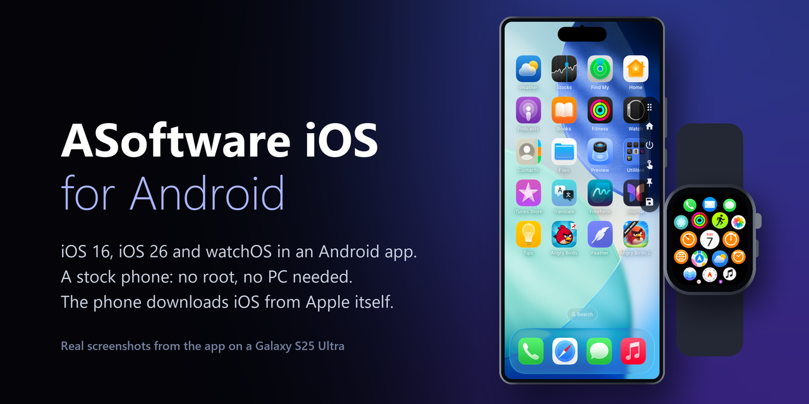

  

  <a href="https://github.com/alpersamur3/asoft-ios-android/releases/latest"><b>Download the app</b></a>
  &nbsp;·&nbsp; <a href="DEVICES.md">Tested phones</a>
  &nbsp;·&nbsp; <a href="#if-something-goes-wrong">If something goes wrong</a>
  &nbsp;·&nbsp; <a href="https://github.com/alpersamur3/asoft-ios">Windows version</a>

Real iOS in an Android app. iOS 16 runs on most 64-bit phones; iOS 26 and watchOS run on phones whose
GPU passes the app's check, which today means most Snapdragon phones (Adreno). A normal phone is
enough: no root, no unlocked bootloader, no Termux and no PC. The app downloads iOS from Apple's own
servers and builds it on the phone.

It is a research preview: slow next to a real iPhone, a setup takes hours, and some phones hit
problems that are not solved yet (listed below). The app and this repository contain no Apple files.

## Will it run on my phone?

| | What the phone needs | Free space while it installs | Space it keeps |
|---|---|---|---|
| **iOS 16** | 64-bit Android 10 or newer. No GPU needed. 6 GB of RAM or more is comfortable; 4 GB phones run it, slowly. | about 26.5 GB | about 6.5 GB, and about 4 GB for its save |
| **iOS 26** | the same, plus a GPU that passes the app's GPU check, and 7 GB of RAM or more (12 GB is comfortable) | about 46 GB | about 12 GB |
| **watchOS** | the same GPU check as iOS 26, and 5 GB of RAM or more | about 20 GB | about 4 GB |

- The GPU check runs before anything is downloaded and takes about 10 seconds. It says plainly whether
  iOS 26 and watchOS will run on your phone, will never run on it, or are not supported on it yet.
- Adreno GPUs (Snapdragon) run through the Turnip driver that comes with the app. Some of them (for
  example the Adreno 750 and the 6xx series) run in a compatibility mode that can stop after long use;
  the app saves before that when it can.
- Mali (most Exynos, MediaTek and Tensor phones), Xclipse and PowerVR GPUs do not run iOS 26 or
  watchOS yet. iOS 16 runs on them, because it draws on the CPU.
- Newer CPUs are much faster. iOS's code runs natively only on cores with the ARMv8.2 features listed
  further down (most phones from 2019 on); on older cores (Cortex-A73, A53) everything is emulated and
  several times slower.
- [DEVICES.md](DEVICES.md) lists the phones people have run it on, with the speed they saw. After iOS
  has run for ten minutes on a phone that is not on the list, the app offers to add it.

## Install

1. Download `ASoftware-iOS-Android-<version>.apk` (about 110 MB) from
   [Releases](https://github.com/alpersamur3/asoft-ios-android/releases/latest) and install it. Android
   asks once to allow installs from your browser or file manager.
2. Open the app, tap **Set up**, and start iOS 16, iOS 26 or watchOS.
3. Leave the phone on its charger and on Wi-Fi, with the app open. If it waits for you, tap **Resume**:
   what is done stays done.
4. When it is done, tap the system on the home screen to start it.

How long it takes depends on the phone. On a Galaxy S25 Ultra, iOS 16 takes about 1.5 hours from
Apple, watchOS about an hour and iOS 26 a few hours. On reporters' phones iOS 16 alone has taken
from about an hour to more than 16 hours.

## While it installs

These are the things that stop most setups, from the reports we get:

- **Android closes the app.** Some phones (Xiaomi, OPPO, realme, vivo, Tecno, Samsung's sleeping
  apps) end long-running apps. Lock ASoftware in the recent apps (hold its card, tap the lock), set
  its battery use to *No restrictions*, and do not press *Clear all*. When Android closes it for low
  memory, the next try of that step uses less memory.
- **Not enough room.** The numbers in the table are what the build needs at its biggest moment. The
  app checks before each step and says how much is missing.
- **The battery.** Below 15 % and not on the charger, the setup waits for the charger.
- **Heat.** When Android reports the phone's heat as *severe* or worse, the setup pauses until Android
  says it has cooled down. Some phones report *severe* while only warm on the charger.
- **iOS 26's second boot.** The last big step, *Second boot: DataMigration*, is iOS setting itself
  up. It takes about an hour on a fast phone and longer on others. The bar stops at 85 % after an hour;
  the minutes in the text are the real progress. On some phones it never finishes: that is
  [#16](https://github.com/alpersamur3/asoft-ios-android/issues/16), still open.

## Using it

- A side bar on the right edge has Home, the side button, a touch lock, screen pinning and saves.
  Tap its handle to show or hide it, drag it to move it. A long press on a button says what it does.
- The phone's volume keys are iOS's, Android's back gesture is iOS's edge swipe, and turning the
  phone's screen off locks iOS.
- Closing the app (swiping it away, or **Save and close**) keeps iOS as it is: next time it is back
  in seconds instead of a boot of a few minutes. Named saves are in the side bar's save button.
- Each system's menu on the home screen (the three dots) has its memory size, Erase, Remove from this
  phone, and for iOS 26 **Install an .ipa…** (decrypted .ipa files; App Store downloads are encrypted
  and do not run).
- Not working yet: the App Store and Apple ID, sound, and GPU acceleration on iOS 16.

## If something goes wrong

1. Read the message: the app says why it stopped, and for most stops what to do.
2. Send the log: on the home screen, **Settings > Logs > App log > Share as a file**, and attach it to
   an [issue](https://github.com/alpersamur3/asoft-ios-android/issues). When the app offers a report
   after a stop, **Report on GitHub** opens an issue with everything filled in. The app sends nothing
   by itself.
3. The open problems most reports are about:
   - [#16](https://github.com/alpersamur3/asoft-ios-android/issues/16): iOS 26's DataMigration never finishes on some phones.
   - [#92](https://github.com/alpersamur3/asoft-ios-android/issues/92): some phones restart during iOS 26's second boot.
   - [#51](https://github.com/alpersamur3/asoft-ios-android/issues/51): Mali GPUs.
   - [#22](https://github.com/alpersamur3/asoft-ios-android/issues/22): Exynos phones with Xclipse GPUs.

Test builds for specific problems appear as pre-releases on the
[Releases](https://github.com/alpersamur3/asoft-ios-android/releases) page.

---

The rest of this page is the technical detail: which hardware features matter and why, what each
setup step does, building the app, and the licenses.

## Which phones, in detail

Nothing in it is specific to one phone. It is developed and measured on a Galaxy S25 Ultra (Snapdragon
8 Elite, 12 GB RAM); everything else in [DEVICES.md](DEVICES.md) comes from users' reports.

- **CPU.** The native EL0 engine runs iOS's own code on the phone's CPU when the cores have LSE atomics,
  RDM, dot product, FP16 (scalar and SIMD), RCpc and DC CVAP (`atomics asimdrdm asimddp fphp asimdhp
  lrcpc dcpop` in `/proc/cpuinfo`). Without them QEMU emulates everything. Speed is mostly the big
  cores: a phone with half its cores small is slower whatever its ARM version.
- **Pointer authentication** is not needed on the phone: iOS 26 and watchOS are arm64e, and the engine
  handles their PAC instructions on CPUs without it (a Snapdragon 888 phone without PAC has finished the
  whole iOS 26 setup).
- **GPU.** iOS 26 and watchOS draw through the phone's GPU. On an Adreno the app uses Mesa's Turnip,
  which it carries. Without sparse binds from host memory the GPU runs in the compatibility mode.
  A phone without an Adreno passes the check only when its own Vulkan driver lacks nothing but sparse
  binds; that route is experimental. On Adreno 6xx phones with an older kernel (msm-5.4 and older) the
  GPU driver refuses the app's memory in 0.1.6; the pre-release
  [v0.1.6-kgsl1](https://github.com/alpersamur3/asoft-ios-android/releases/tag/v0.1.6-kgsl1) fixes that.
- **RAM.** iOS 16 asks for 7 GB and touches about 2.7 GB of it. iOS 26's memory is 3, 4 or 6 GB and
  watchOS's 2 or 3 GB, set in their menu on the home screen; the smaller ones are the default on a phone
  under 10 GB. Below 7 GB of phone RAM (iOS 26) or 5 GB (watchOS) the app warns but does not refuse.
  On the S25 Ultra iOS 26 left Android 1.5 GB at 3 GB and 0.8 to 1.0 GB at 6 GB.
- **Free memory for iOS** (home screen, Settings): while iOS runs, the background processes of other
  apps are ended every 90 s, so Android does not close iOS for lack of memory. Android 14 and later
  let an app end only its own, so there the app asks adb's shell on the phone itself (`am kill-all`)
  over Wireless debugging: pair once (Settings on the home screen > Wireless debugging; the code from
  Developer options goes into a notification of the app). Wireless debugging needs Wi-Fi and is off
  again after a restart of the phone until it is turned on.

## What works, in detail

### iOS 16

- iOS 16.7 (20H392) full screen, touch, iOS's own keyboard, Safari with HTTPS pages.
- Side bar: Home, the side button (lock or wake iOS), a touch lock (touches stop reaching iOS), pin
  (Android's screen pinning: the phone's edge swipes no longer pull down the notification shade or go
  home over iOS), saves.
- Quick boot: swiping the app away, or Save and close, keeps iOS as it is; it comes back in about
  10 s instead of a boot of 2 to 4 minutes. Named saves (about 3 GB each) can be taken and loaded.
- Turn off (in the side bar's saves, or on the home screen) shuts iOS down without a save; the next
  start boots. The notification has only Save and close. The last quick save stays as a way back:
  Go back, on the home screen or in the saves, returns to it with the memory it was saved with, until
  the next Save and close replaces it.
- Settings and apps you add stay on the phone's own copy of the disk.

### iOS 26 (preview)

iOS 26.6.2 in Apple's research VM (vphone600), drawing on the phone's GPU: Metal is translated to
Vulkan (reims-vgpu, metal2vulkan). Home screen, apps, touch, keyboard, Liquid Glass; quick boot and
saves as for iOS 16. It boots in about 3 minutes and is slow for about 15 minutes after a boot. The app
saves by itself once iOS has settled after a boot, and before QEMU reaches Android's limit on memory
mappings. The screen is 2x by default (faster); 3x (sharp) is in iOS 26's menu on the home screen. On
a disk set up with Always On Display, the side button takes iOS to it and a touch there wakes it; iOS's
own Auto-Lock is set to Never there, because the app cannot see iOS go to its Always On Display by
itself.

### watchOS (preview)

watchOS 27.2 as an Apple Watch Series 9, on the phone's GPU like iOS 26, in a drawn watch: tap the
crown to press it, drag it to turn it; the side button is under it. Its own disk and saves. The first
start boots in 5 to 7 minutes (longer on a hot phone); a save comes back in about 5 s with the right
time. Set up installs it from Apple, with or without iOS 26.

## Installing on the phone from Apple, in detail

Set up builds iOS 16, iOS 26 and watchOS on the phone itself from Apple's files, the way the Windows
installers do: no PC, no adb.

### iOS 16

- It downloads only the parts of Apple's iOS 16.7.16 IPSW (iPhone X) the disk is made of, 5.8 GB,
  straight from Apple's servers: 8 connections, 32 MB pieces written in place, each part checked
  against the IPSW's own CRC-32. It picks the fastest of Apple's servers, goes on after an app kill,
  a restart or a lost network, can wait for Wi-Fi (Download on Wi-Fi only), and has Pause and Cancel
  on its notification.
- Then the Windows installer's helper VM (a small arm64 Linux that comes with the app) runs in the
  app's QEMU: it makes the kernel with the iPhone's device tree and builds the iOS disk from the
  downloaded images, as `Build-iOSDisk.ps1` does on Windows. The disk is packed and set up like one
  brought from a PC, then iOS is started once until its lock screen and saved, so your first start
  takes seconds.
- It needs about 26.5 GB free at its height (with less, the downloaded files go as soon as the disk no
  longer needs them) and leaves about 6.5 GB, plus about 4 GB for the save. On the S25 Ultra the whole
  setup takes about 1.5 hours from Apple (51 minutes with the files already on the phone: the disk 20,
  the first start 29).

### iOS 26 and watchOS

- First the GPU check (above). When it fails, the screen says whether iOS 26 will not run on this phone
  or is not supported yet, with its log to copy or share (please send it).
- Their shared part comes once, whichever is installed first: cloudOS 26.4's kernel, firmware and GPU
  driver from Apple, about 1 GB.
- Then each OS's own IPSW parts from Apple, and the helper VM builds its disk with the Windows
  installers' own steps. iOS 26 is then started once through its first-boot work (iOS's data
  migration, about an hour on a fast phone), watchOS until its watch face.
- watchOS: about 5 GB from Apple, about an hour, about 20 GB free at its height, keeps about 4 GB.
  iOS 26: about 10.2 GB from Apple, a few hours, about 46 GB free at its height, keeps about 12 GB
  (on the S25 Ultra 99 minutes with the files already on the phone: the disk 31, the data migration 45).
- Besides Apple's servers they fetch, from GitHub: a small iOS sysroot (bash and file tools the disk
  steps run, [jprx/darwin-vm](https://github.com/jprx/darwin-vm)), our device-tree fix-up (qemu-sptm),
  the GPU compiler plugin (vphone-cli's open-source GraphicLoader with our patch, an asoft-ios release),
  and the FCS key list [blacktop/ipsw](https://github.com/blacktop/ipsw) carries, used when Apple's key
  service does not answer.

The app and this repository hold no Apple file: what is built comes from Apple's servers on the phone.

## Setting it up from a PC

1. On a Windows PC, install [ASoftware iOS](https://github.com/alpersamur3/asoft-ios) with iOS 16.
2. Install this app on the phone (iOS 16 needs about 6.5 GB, and 4 GB more for a save).
3. On the PC, run `Send-ToPhone.cmd` from the ASoftware iOS folder. It packs that iOS into
   `ASoftware-iOS16.asoft` (about 6.5 GB) and, with the phone on USB and USB debugging on, sends it
   to the app. Otherwise copy the file to the phone.
4. In the app: Set up > From your PC > Choose file… (or Import, when the file is already there), then
   Start iOS 16. The first start takes a few minutes (2 to 4 on our phone).

The file is made on your PC from what the Windows installer downloaded from Apple. Neither this
repository nor the app holds any Apple file. Do not share the file.

## How it works

QEMU runs as the app's child process. A locked phone gives an app no hypervisor, so QEMU emulates
XNU's kernel, but the iOS processes themselves run on the phone's CPU: the native EL0 engine maps
each iOS address space into a helper process and runs its arm64 code there, trapping to QEMU for
system calls and page faults. On CPUs without the ARMv8.2 features above the engine stays off and QEMU
emulates everything. iOS 16's screen is read straight from the guest's RAM into a GLES texture each
display frame; iOS 26's and watchOS's frames come from reims-vgpu through a frame file descriptor.
Input goes over QMP.

## Building

- iOS 16's QEMU and `qemu-img`: [qemu-sptm](https://github.com/alpersamur3/qemu-sptm), branch
  `asoft-android-ios16`, built in Termux on the phone (`-D__TERMUX__ -O2 -fno-emulated-tls`).
  `pull-libs.sh` copies them (as `libqemu.so`, `libqemuimg.so`) and their Termux libraries into
  `app/src/main/jniLibs`.
- iOS 26's QEMU (`libqemu26.so`): branch `asoft-android` with reims-vgpu and metal2vulkan linked in,
  built with the NDK; Turnip and the Vulkan loader beside it. `pull-libs26.sh` puts them in
  `app/src/main/jniLibs26`.
- The setup from Apple: `pull-setup.sh [ASOFT_IOS_CHECKOUT]` copies the helper VM (`Image.gz`,
  `initrd.gz`; `Image16k.gz` from `$KERNEL16K`, built with `setup/helper-kernel16k.config`), the
  iOS 16 kernel, the tools that make `payload.bin` and `asoft-setup.json` (the member and step list
  the installers share), and for iOS 26 and watchOS the Windows installers' Linux step bodies and
  scripts (`ios26/`, `watchos/` there) with this repository's `setup/phone` jobs, into
  `app/src/main/assets`.
- The app: `./gradlew assembleDebug` (Android Studio's JDK, SDK 36, NDK 29). A release build is
  signed when `~/.android/asoft-ios-release.properties` (or `$ASOFT_SIGNING`) names a key.
- Tests and measurements on a phone over adb: `dev/` (`dev/test-*.sh`; input goes to the phone only
  while the app is on top and the phone is unlocked).

## Licenses

The app's code: MIT (LICENSE). The APK also carries:

- QEMU 11.1 (GPL v2): source at https://github.com/alpersamur3/qemu-sptm, branches `asoft-android`
  (iOS 26 and watchOS) and `asoft-android-ios16` (iOS 16).
- reims-vgpu and metal2vulkan (GPL v2 or later, or LGPL v3 or later): sources at
  https://github.com/alpersamur3/reims-vgpu and https://github.com/alpersamur3/metal2vulkan, branch
  `asoft-android`.
- Mesa's Turnip Vulkan driver (MIT) and the Khronos Vulkan loader (Apache 2.0).
- For the setup from Apple: our XNU kernel for iOS 16 (Apple Public Source License 2.0; built from
  Apple's XNU with the patches in [asoft-ios](https://github.com/alpersamur3/asoft-ios) `xnu/`),
  and the Windows installer's helper VM (`installer/helper` there): Linux 6.12 (GPL v2; kernel.org's
  6.12.114 with `installer/helper/kernel.config`, and for the phone's engine also
  `setup/helper-kernel16k.config` here), Ubuntu 24.04 arm64 packages under their own licenses
  (sources at https://launchpad.net/ubuntu), and apfs-fuse (GPL v2,
  https://github.com/sgan81/apfs-fuse).
- Termux packages QEMU links (GLib, GnuTLS, Nettle, libslirp, pixman, zstd and others, under
  their own licenses): sources at https://github.com/termux/termux-packages.
- Conscrypt (Apache 2.0, https://github.com/google/conscrypt): TLS 1.3 for the pairing with Wireless
  debugging. The adb client itself (`Adb*.java`, `Spake2.java`) is the app's own, written after
  AOSP's adb (Apache 2.0); SPAKE2's two points are BoringSSL's.

Not affiliated with Apple. iOS is Apple's.
